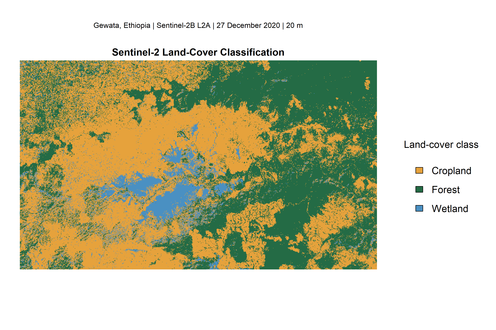
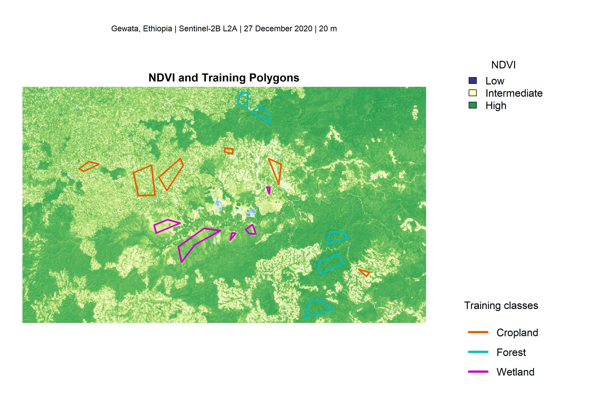
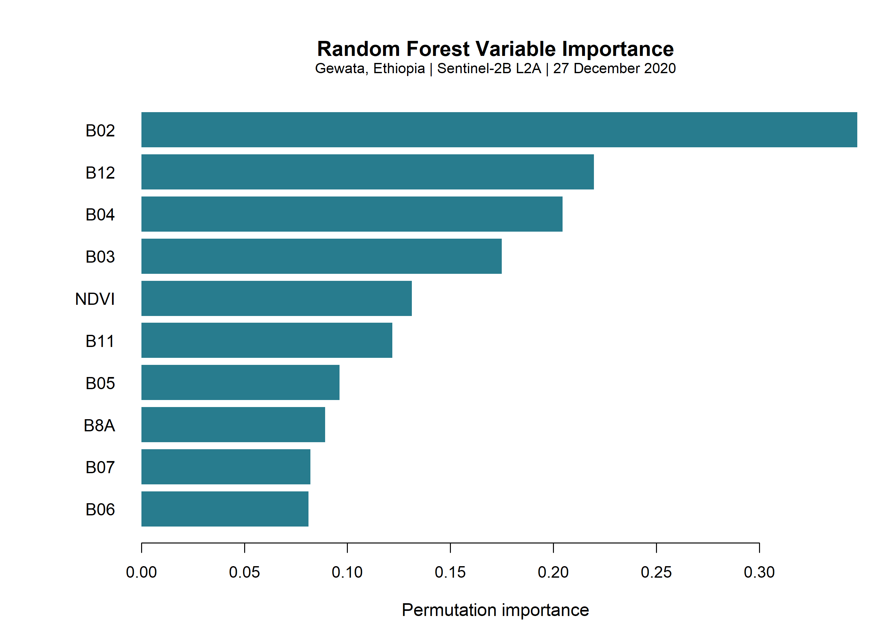
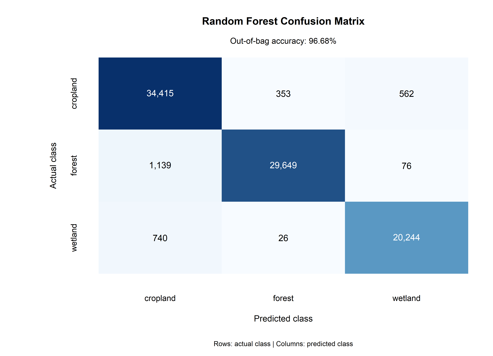
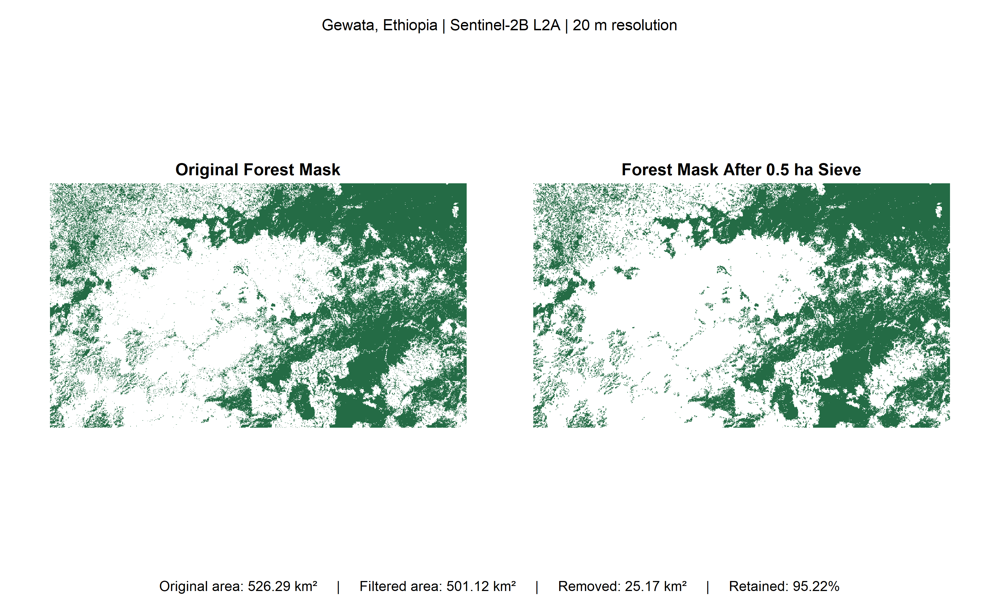
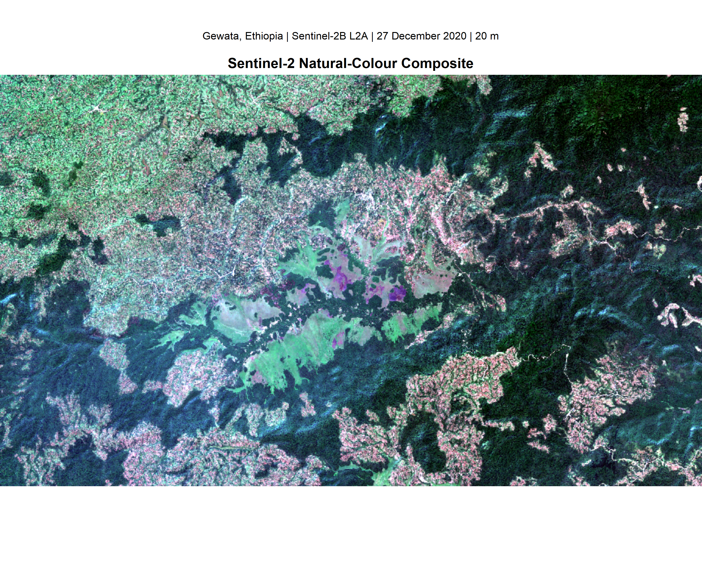

# Sentinel-2 Land-Cover Classification in Gewata, Ethiopia

**An applied remote-sensing project using Sentinel-2 imagery, Random Forest classification and forest patch analysis.**

## Project overview

This project uses Sentinel-2 Level-2A satellite imagery to classify land cover in Gewata, Ethiopia. It combines multispectral satellite data, the Normalised Difference Vegetation Index (NDVI), supervised Random Forest classification and spatial analysis of forest patches.

The analysis distinguishes three land-cover classes:

- Cropland
- Forest
- Wetland

The project also examines forest patch patterns and applies a minimum mapping unit to reduce small isolated forest patches in the classified output.

The work builds on concepts and practical exercises from Wageningen University's (WUR) Advanced Raster Analysis course, with an extended analysis and publication outputs prepared for this portfolio project.

## Project objectives

1. Prepare Sentinel-2 multispectral imagery for land-cover analysis.
2. Calculate NDVI and combine it with spectral bands as a classification predictor.
3. Train a Random Forest model using reference training polygons.
4. Assess model performance using out-of-bag (OOB) estimates and class-level recall.
5. Produce a land-cover classification and estimate the area represented by each class.
6. Examine forest patch patterns under different neighbourhood definitions.
7. Apply a 0.5-hectare minimum mapping unit to the forest mask and quantify the resulting changes.

## Study area and data

**Study area:** Gewata, Ethiopia\
**Satellite data:** Sentinel-2 Level-2A\
**Acquisition date:** 27 December 2020\
**Spatial resolution:** 20 metres\
**Coordinate reference system:** WGS 84 / UTM zone 36N (EPSG:32636)

The Sentinel-2 image contains the following spectral bands:

- B02 — Blue
- B03 — Green
- B04 — Red
- B05 — Vegetation red edge
- B06 — Vegetation red edge
- B07 — Vegetation red edge
- B8A — Narrow near-infrared
- B11 — Short-wave infrared
- B12 — Short-wave infrared

The Scene Classification Layer (SCL) was excluded from the predictor stack.

Reference training data consist of 16 polygons supplied with the original WUR practical materials:

| Land-cover class | Training polygons |
|---|---:|
| Cropland | 6 |
| Forest | 5 |
| Wetland | 5 |
| **Total** | **16** |

The source training CSV does not specify a coordinate reference system. EPSG:32636 was assigned following a coordinate-range and spatial consistency check. This is an analytical assumption rather than a CRS declaration supplied in the original CSV.

## Methodology

### 1. Image preparation

The Sentinel-2 raster was loaded and its layers assigned their corresponding band names. The SCL layer was excluded, and the remaining spectral bands were used in the analysis.

### 2. Vegetation index calculation

NDVI was calculated using the narrow near-infrared and red bands:

\[
NDVI = \frac{B8A-B04}{B8A+B04}
\]

The resulting vegetation index was included alongside the nine spectral bands, producing ten predictor variables.

### 3. Training data extraction

Reference polygons were used to extract pixel-level spectral and NDVI values. The resulting training dataset contained 87,204 records.

### 4. Random Forest classification

A Random Forest classifier was fitted using the `ranger` package in R.

Main model settings:

- Number of trees: 100
- Variable importance: permutation-based
- Random seed: `0xfedbeef`
- Predictor variables: nine Sentinel-2 bands and NDVI
- Classification classes: cropland, forest and wetland

### 5. Model performance assessment

Model performance was examined using the out-of-bag error and class-level recall.

OOB estimates provide an internal assessment of model performance. They should not be interpreted as independent validation against a separate test dataset.

### 6. Forest patch analysis and sieving

The forest classification was converted into a binary forest mask. Patch patterns were examined using Queen's case (eight-neighbour) and Rook's case (four-neighbour) connectivity.

A 0.5-hectare minimum mapping unit was subsequently applied using Queen's case connectivity. At a 20-metre pixel resolution, each pixel represents 400 m²; a minimum of 13 pixels was therefore used to meet the specified threshold.

## Results

### Land-cover classification

The classified raster contained 3,162,564 pixels, representing a total raster footprint of approximately 1,265.03 km².

| Land-cover class | Area (km²) |
|---|---:|
| Cropland | 640.12 |
| Forest | 526.29 |
| Wetland | 98.62 |
| **Total** | **1,265.03** |



*Figure 1. Classified land-cover distribution in the study-area raster footprint.*

### Training polygons and NDVI



*Figure 2. NDVI and reference training polygons used in the classification.*

### Random Forest performance

| Metric | Result |
|---|---:|
| OOB accuracy | 96.68% |
| OOB error | 3.32% |

Class-level recall:

| Class | Recall |
|---|---:|
| Cropland | 97.41% |
| Forest | 96.06% |
| Wetland | 96.35% |

These results are based on the model's OOB estimates and do not constitute independent validation.



*Figure 3. Permutation-based variable importance scores. These scores are not percentages or measures of explained variance.*



*Figure 4. Confusion matrix from the model performance assessment.*

### Forest patch analysis

The connectivity definition affected the number of mapped forest patches.

| Connectivity | Patch count | Single-pixel patches |
|---|---:|---:|
| Queen's case | 29,557 | 15,284 |
| Rook's case | 50,858 | 29,960 |

Queen's case connectivity groups pixels that touch at an edge or corner, whereas Rook's case connectivity considers edge-sharing neighbours only.

### Minimum mapping unit

A 0.5-hectare minimum mapping unit was applied to the forest mask.

| Metric | Before sieving | After sieving |
|---|---:|---:|
| Forest pixels | 1,315,728 | 1,252,810 |
| Forest area (km²) | 526.29 | 501.12 |

The filtering removed 62,918 forest pixels, equivalent to approximately 25.17 km² or 4.78% of the original mapped forest area. Approximately 95.22% of the original forest area was retained.



*Figure 5. Comparison of the forest mask before and after application of the minimum mapping unit.*

### Natural-colour composite



*Figure 6. Natural-colour Sentinel-2 composite of the study area.*

## Repository structure

```text
sentinel-2-land-cover-classification/
├── README.md
├── .gitignore
├── Data/
│   └── README.md
├── Scripts/
│   └── 01_sentinel2_land_cover_classification.R
└── Publication/
    ├── Figures/
    │   ├── 01_sentinel2_land_cover_classification.png
    │   ├── 02_ndvi_training_polygons.png
    │   ├── 03_random_forest_variable_importance.png
    │   ├── 04_random_forest_confusion_matrix.png
    │   ├── 05_forest_mask_sieving_comparison.png
    │   └── 06_sentinel2_natural_colour_composite.png
    └── Outputs/
        ├── class_recall.csv
        ├── forest_patch_summary.csv
        ├── forest_sieving_parameters.csv
        ├── forest_sieving_results.csv
        ├── land_cover_area.csv
        ├── model_performance.csv
        └── variable_importance.csv
```

## Reproducibility

The analysis was conducted in R using the `terra`, `sf` and `ranger` packages.

To reproduce the analysis:

1. Clone or download this repository.
2. Obtain the original Sentinel-2 raster and training polygon data using the source links and instructions in `Data/README.md`.
3. Place the source files in the directory structure specified in `Data/README.md`.
4. Install the required R packages:

```r
install.packages(c("terra", "sf", "ranger"))
```

5. Open and run:

```text
Scripts/01_sentinel2_land_cover_classification.R
```

The script creates a timestamped output directory under `Outputs/` containing the classification raster, forest masks, model object and analytical CSV files.

The six publication figures are stored in `Publication/Figures/`. They are supplied as curated outputs and are not all generated by the main analysis script.

Exact package versions and the original software environment have not yet been captured in a dependency lockfile. Results may therefore vary slightly across software environments.

## Limitations

- The analysis uses a single Sentinel-2 acquisition date and does not capture seasonal or interannual land-cover variation.
- The classification is limited to three land-cover classes.
- Training data consist of 16 reference polygons, and their representativeness may affect classification performance.
- The reported OOB accuracy is an internal model estimate, not independent validation.
- The training data CRS was assigned as EPSG:32636 following spatial checks because the original CSV did not specify one.
- National or regional land-cover conclusions should not be inferred beyond the extent of the analysed raster footprint.
- Forest patch counts depend on the selected connectivity definition and minimum mapping unit.
- Patch analysis describes spatial patterns in the classified raster; it does not establish ecological connectivity, habitat quality or biodiversity status.
- The minimum mapping unit removes small mapped patches and therefore changes the mapped forest area.

## Data sources and acknowledgements

This project builds on practical materials from Wageningen University's Geoscripting course:

- [Advanced Raster Analysis — source repository](https://github.com/GeoScripting-WUR/AdvancedRasterAnalysis)
- [Advanced Raster Analysis — course documentation](https://geoscripting-wur.github.io/AdvancedRasterAnalysis/)

The original practical materials include the Sentinel-2 image and reference training polygons used in this analysis. Users reproducing the project should obtain those source assets from the original distribution and consult the applicable terms.

**Satellite data acknowledgement:** Contains modified Copernicus Sentinel data 2020.

The original source materials and the user's analytical contributions should be considered separately when determining applicable licensing and reuse conditions.

## Author's contribution

This portfolio project demonstrates practical application of remote sensing, raster processing, supervised machine learning and spatial analysis using R.

The analysis, model implementation, additional forest patch assessment, publication figures and presentation of results were prepared as part of this project.
